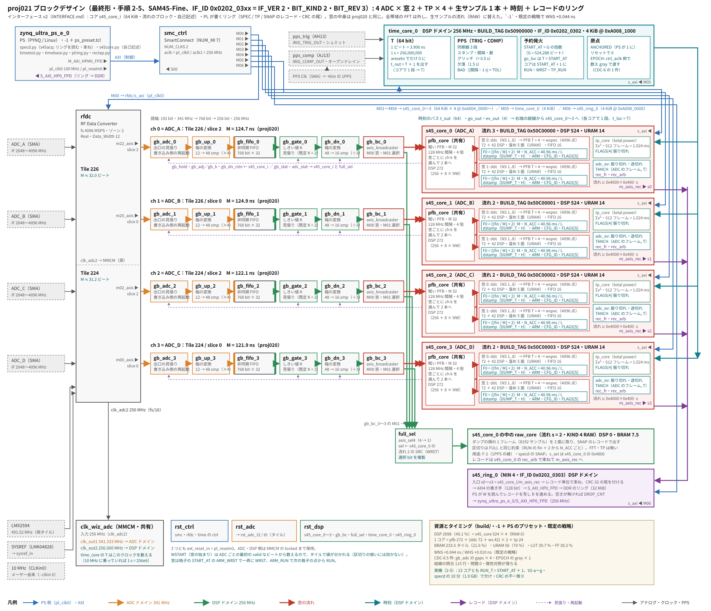

# 全体の流れ

SAM45-Fine（BIT_KIND 2・BIT_REV 3）を例に、ADC から受け側までのデータと時刻の道をたどる。約束（番地・レコード・命令）の正は [`../spec/`](../spec/)、ここは「なぜこの形か」と「どこを読めばよいか」。



（図は [`sam45-fine/block_design.py`](sam45-fine/block_design.py) で描く。`build.tcl` の配線を変えたら図も直す）

## データの道

```
ADC_A..D ─ RFDC ─ ギアボックス ─┬─ s45_core_i（ADC ごと）
 4096 MSPS  12 サンプル/語      │    win_core: 粗い PFB（共有）→ 窓ごとに DDC → wspec（PFB T=4・FFT・積分）
            341.33 MHz          │              TP（Σx²、1.024 ms）
                                │    rec_fr: 閉じたダンプ → レコード
                                └─ axis_sel4 ─ s45_core_0 の RAW の流れ（生サンプルの SNAP）
s45_core_i の m_axis_rec ─ s45_ring（順番回し・CRC・DDR へ書く）─ HP0 ─ PS の DDR のリング
specd（PS）: リングを読む → 確かめる（CRC・SEQ）→ 束ねる（tint）→ 時刻を付ける → float32 → s45proto v2 → 受け側
```

| 段 | 何をするか | 読むところ |
|---|---|---|
| RFDC | 4 本を 4096 MSPS で直接サンプリング（第 2 ナイキスト、IF 2048〜4096 MHz）。1 語 12 サンプル・341.33 MHz | [`../spec/hardware.md`](../spec/hardware.md)、ADR [0005](../decisions/0005-direct-sampling-4096msps-zone2.md) |
| ギアボックス | 12 サンプル × 341.33 MHz → 16 サンプル × 256 MHz（DSP ドメイン）。gb_up（4 語 → 48 サンプル）→ 非同期 FIFO → gb_dn（3 語）。起動の途切れの対策に gb_adc・gb_gate | [`cores.md`](cores.md) の「ギアボックス」 |
| 粗い PFB | 32 点・ch 間隔 128 MHz・4 倍オーバーサンプリング。分岐の和と 16 点 DFT は ADC で共有し、窓ごとに 1 ch を取り出す | `pfb_core` |
| DDC | 窓ごとに NCO で中心へ寄せ、半帯域 ÷2 を NS 段（幅 256 / 2^(NS−1) MHz） | `ddc_core`・`hb2`・`hb2s` |
| 窓の分光 | 溜め（5 面）→ PFB（T = 4）→ 4096 点 複素 FFT（realtime の IP）→ 電力 → 64 bit で積分 | `wspec_core`、ADR [0011](../decisions/0011-narrowband-windows-coarse-pfb-ddc.md)・[0012](../decisions/0012-window-pfb-t4.md) |
| TP | ADC ごとの Σx²（14 bit）を 1.024 ms で区切る | `tp_core`（win_core の共通部） |
| レコード | 閉じたダンプを SPEC（type 1）・TP（type 2）・SNAP（type 4）のレコードにする | `rec_fr`・[`../spec/interface.md`](../spec/interface.md) の 4.4・4.6 |
| リング | コア 4 本のレコードを順番回しで 1 本にし、尾（CRC-32）を付けて DDR のリングに書く。溢れたらレコードごと捨てて DROP_CNT | `s45_ring`・`rec_arb`・interface 4. |
| specd | リングを読み、確かめ、tint に束ね、時刻を付け、float32 にして送る | [`../user/specd.md`](../user/specd.md)・interface 5.・ADR [0017](../decisions/0017-specd-acquisition-server.md) |

**値を切るのはネットワークだけ**（PL とリングは u64 の生の積分値。束ねは整数の和のまま bit 単位で正しい。interface 4.5）。

## 時刻の道

```
1PPS ─ LPF ─ PPS Clk ─ time_core: T（64 bit ビート）・PPS のスタンプ・START_AT の発火・健全性の素
                          │ t・go・ev のバス（各コアで 1 段受ける。段数は time_core が先に足す）
                          └→ 各コアの dstamp: ダンプの最初のフレームの頭の T（DUMP_T）と健全性（DUMP_H）
specd: 錨（UTC 秒 ↔ スタンプ）＋ CAL（pps_det・adc_to_core）＋ D_eff → utc_ns
```

- 時刻は**ビートの数え**で貼る（1PPS を毎秒のトリガにしない。ADR [0008](../decisions/0008-time-labels-beat-counter-and-start-at.md)）。全コアは START_AT の同じビートで RUN を受ける
- 区切りは時刻の格子 G・BASE・tint の倍数に置く（ADR [0009](../decisions/0009-time-grid-and-integration-time.md)）。式と値は [`../spec/timing.md`](../spec/timing.md)
- 1PPS は ADC に入れない（MTS も使わない。ADR [0007](../decisions/0007-no-mts-no-pps-into-adc.md)）。ADC と時刻の対応（adc_to_core）は、試験のときだけ 1PPS を ADC にも入れて測る（F-2）

## クロックのドメイン

| ドメイン | 周波数 | 中身 |
|---|---|---|
| ADC | 341.33 MHz（fs / 12） | RFDC の出口・gb_adc・gb_up・FIFO の書き込み側 |
| DSP | 256 MHz（fs / 16 = 1 ビート） | FIFO の読み出し側から後ろ全部（コア・time_core・リング）。コアの AXI4-Lite も 256 MHz |
| 制御 | pl_clk0 100 MHz（PS が出す） | AXI4-Lite の相互接続の PS 側・RFDC の AXI・time_core の ctrl_aclk（エポックの数え。MMCM に依らない） |

ADC と DSP のクロックは同じ MMCM の VCO（1024 MHz）を 3 分周・4 分周したもの。語の周期はどちらも 11.72 ns で厳密に等しい（gb_gate の冒頭）。

## 健全性

どの段の異常も、**黙って値を変えない**のが約束（[`../knowledge/verification.md`](../knowledge/verification.md)）。

| どこで | 何を | どこに出る |
|---|---|---|
| time_core | PPS が来ない・間隔の外れ・グリッチ・原点なし | DUMP_H [3:0] |
| adc_ev・tp_core | 振り切れ・入力の途切れ | DUMP_H [4]・[5]、TP の FLAGS[4] |
| wspec・pfb・ddc | 飽和・溜めの遅れ・hb2s の前提の破れ | 窓の FLAGS・DUMP_SAT・診断のレジスタ |
| rec_fr・s45_ring | 読み遅れ・溢れ・書きの誤り | REC_LATE・DROP_CNT・ERR |
| specd | CRC・SEQ・束の欠け・tp_jump | EVENT（DROP・ERROR）・STATUS・健全性 [16]・[17] |
